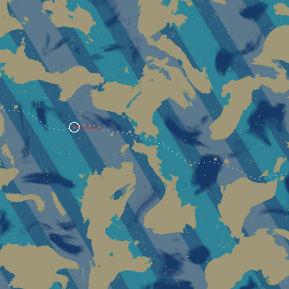
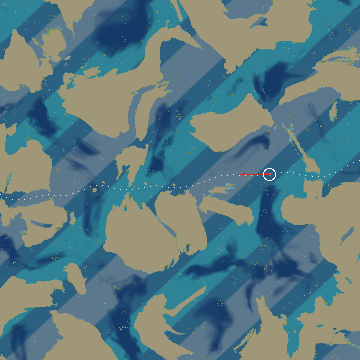
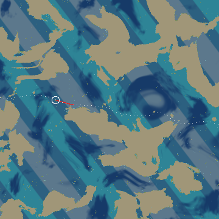
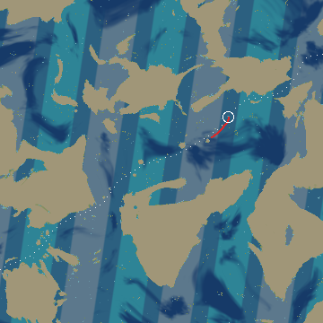

## Context

On main 2e896b2 the land mask is one field: 6.5 km continent noise with bay and cove octaves, thinned by a region offset beyond 2.2 to 5 km of the start. Whatever the region, land comes as blobs a few kilometres across scattered in every direction. Measured with the real whale mover over an hour on seeds 1 to 50 and the six test seeds (`tools/seed-sweep.ts`, the same tool and metric before and after), natural land is within 6 km of the whale 95 percent of the hour on average (58 to 100 percent by seed, 99 at the median), and the longest stretch with none is at most 6 minutes: land on every side.

The whale cruises at 16 to 28 m/s and makes about 66 km good in an hour, so the layout's scales are set by travel time: a 40 km open stretch is about 35 minutes, a coast passing within view lasts 5 to 15 minutes.

Land is hazed out between 6.2 and 7.8 km (`landmesh.ts`), so "a coast in view" here means natural land within 6 km of the whale. The open sea's rocks (one per 2 km cell) are not counted.

## Goals / Non-Goals

**Goals:** Earth-like at planet scale (big continents, about a third land, wide connected oceans); along the migration an open horizon most of the time with a coastline now and then; travel at least as good as step 3; deterministic and streamable; the opening, the height function and the land worker's interfaces unchanged.

**Non-Goals:** Terrain detail, towns and life (the land branch works on whatever land exists); weather and waves; a globe (the world stays an endless plane).

## Decisions

### D1 The lane follows the current

The whale's journey is the ocean current (`createCurrent`, a steady heading with eddies bending it by up to 30 degrees). The planet integrates that current from the start (midpoint rule, 500 m steps, cached in 128 km chunks, forward and back) into a centreline, and measures every point by `s` (metres along the steady heading) and `q` (metres across, from the centreline). A swimmer following the current stays within 300 m of the centreline over 300 km (tested). The journey heading is the planet's heading (the exit channel's direction), so lane and current agree by construction; the open-water flood that chose a heading is gone.

The whale itself wanders off the centreline by up to about 9 km over an hour (its slow wander and plan bias). The lane keeps 6 km either side open whatever the continents do; beyond that the whale meets ordinary coasts, which step 3's planner handles (the sweep shows it).

Alternative rejected: a stream function in closed form. The current's eddy term is normalised where it is strong, so no closed form matches it (a swimmer drifts 1 to 12 km off over 400 km).

### D2 Continents: a uniform field slid into place

Continents are warped fractal noise (`simplex-noise`, already a dependency) of 260 km wavelength, five octaves, land above a level that makes about a third of the planet land. A level that rose toward the lane was tried and dropped: it draws coasts parallel to the route and long canals. Instead the field stays uniform (so the map reads as continents and oceans) and is slid: of 64 seeded offsets the planet keeps the one whose continents come within 6 km of the first 500 km of lane, and of its first 80 km, closest to 15 percent of the way, penalising any run over 25 km. This costs 20 to 60 ms once per land build (main thread and worker).

Where the lane still crosses a continent the kept-open strait widens with the land's bulk (50 km per unit of noise above the level), so the heart of a continent is cut by a sound with its shores out of view, and only margins come near.

### D3 Islands along the way

Every 32 km stretch of lane has, with odds 0.8, a large island (radius 1.5 to 8.5 km, its near shore at least 2.5 km off the centreline, to one side) or, three times in ten, a cluster of islets of 2.5 to 4.5 km radius the lane runs through. Outlines are ragged. Out in the oceans, away from the lane (from 10 km off it), archipelago zones of 60 km scale scatter islet clusters for the map and for whales that wander. Nothing within 25 km of the start along the lane: open sea first, after the opening's coast.

### D4 Coast-in-view target

Chosen: natural land within 6 km for about a quarter to a third of the time on average, open stretches of 30 to 60 minutes typical. Why: the captain asked for open horizon most of the time and a coastline now and then; at 66 km an hour a share near 30 percent gives two or three coasts an hour, and under a quarter left hour-long stretches with nothing on most seeds. Measured over the whale's hour on seeds 1 to 50 and the test set: 28 percent on average (median 30, 10 to 68 by seed), longest open stretch 35 minutes at the median; along the first 300 km of the lane's centreline 23 to 32 percent on the test seeds.

### D5 Mask

Beyond the opening (`REGION_FROM` 2.2 km to `REGION_FULL` 5 km) `maskAt` is the planet's macro mask (open ocean at −1.6, continents at up to 1, about 0.001 per metre across a coast, the slope the old coasts had, so shelves, depth and `reach` read the same) plus the old coast detail (6.5 km noise, bays, coves) faded out below −1.1, where it could not raise land. In the open ocean the detail is not computed, so an ocean sample costs less than before. The opening, its exit channel, `heightAt`, `surfaceAt` and their signatures are unchanged; the land worker rebuilds the same world from the same (seed, view, offset).

### D6 Four seas on the layout

Tropical, temperate and polar follow latitude: a seeded north axis crossing the lane at 35 to 55 degrees, equator to pole over 120 km, bands blended over 5 km; the start is mid-temperate. Deep blue is open ocean 22 to 40 km or more from any continent. Regions keep their islet gain; the land offset is gone (the layout decides land).

### D7 Map images

`tools/world-map.ts <seed> <out.png> 800 360 60`: 800 km square, the start (white ring) a quarter from the centre so most of the map lies ahead, the lane's centreline dotted, the whale's first hour in red, sea tinted by region (teal tropical, blue temperate, grey-blue polar, navy deep blue).

| Seed 42 | Seed 7 |
|---|---|
|  |  |
| **Seed 1234** | **Seed 99** |
|  |  |

## Numbers

| Measure (one hour, seeds 1 to 50 and the test set) | Step 3 (main) | After |
|---|---|---|
| Net over path | 0.55 to 0.97, median 0.88 | 0.83 to 0.99, median 0.95 |
| Worst ten minutes | 2.4 km (seed 38) | 7.2 km (seed 23) |
| Seeds under 1.5 km in a five-minute window | 1 (seed 34, 0.5 km, at the start) | 1 (seed 23, 1.3 km, at the start) |
| Net in the first 10 minutes | 4.0 to 11.7 km, median 10.5 | 5.5 to 12.0 km, median 11.0 |
| Natural land within 6 km, share of the hour | 58 to 100 percent, mean 95, median 99 | 10 to 68 percent, mean 28, median 30 |
| Longest open stretch in the hour | 0 to 6 minutes, median 0 | 8 to 54 minutes, median 35 |

Four seeds of 56 spend more than half their first hour in sight of a coast (16, 25, 34, 43): their lanes run past continents early, as a real coastal passage would.

## Risks / Trade-offs

- Beyond the 500 km the placement looks at (about 7 to 8 hours of travel) the continents fall as they may: longer coastal or open stretches are possible. The strait widening keeps the way open.
- The lane is measured on the steady heading's axis, so `q` is the across distance only to within the cosine of the current's bend (up to 30 degrees).
- `ocean-regions` is modified against the unarchived `add-ocean-migration`; archive that change first.
- Saved seeds look different beyond the opening.
